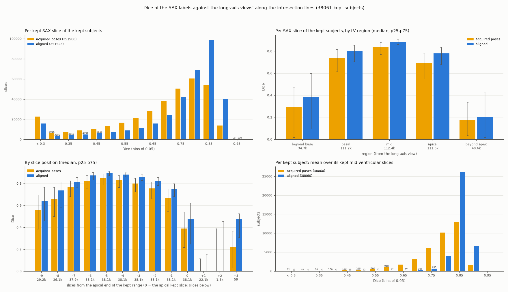
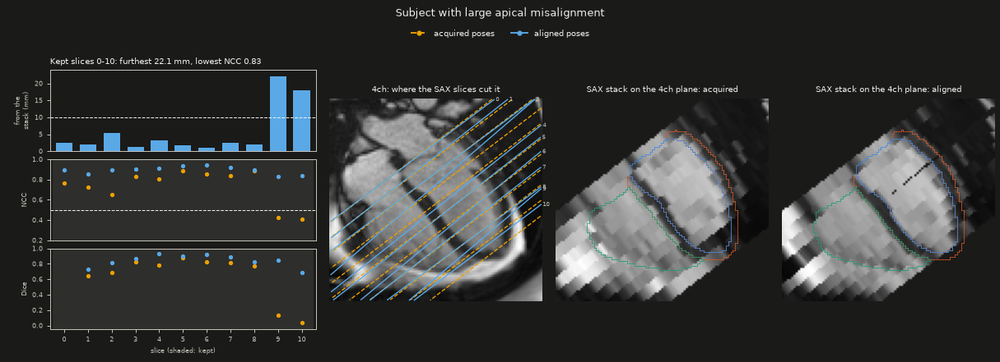
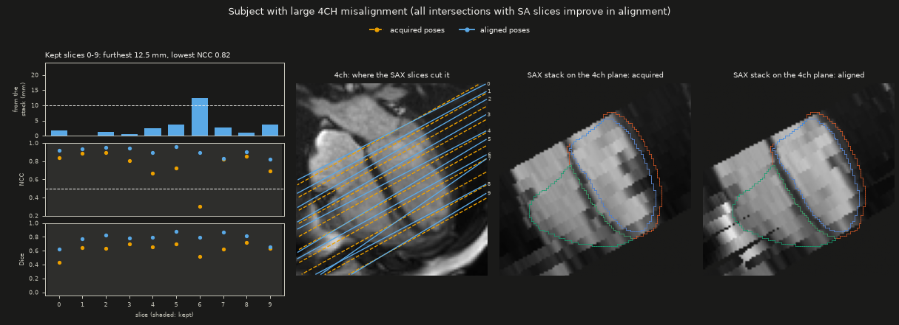
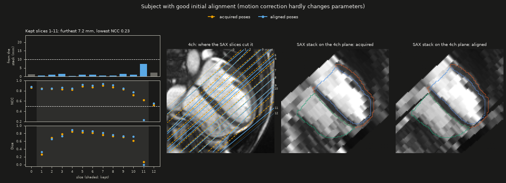
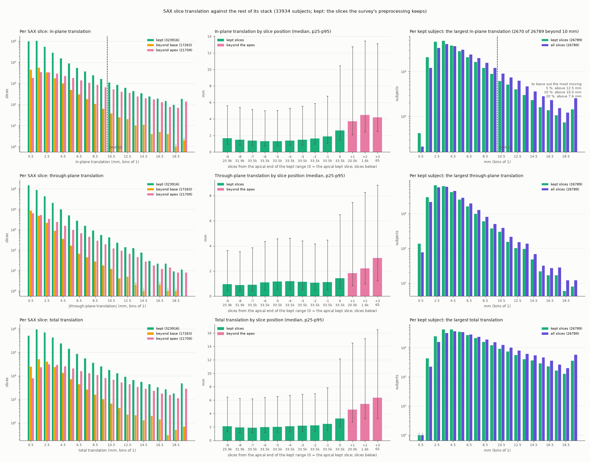
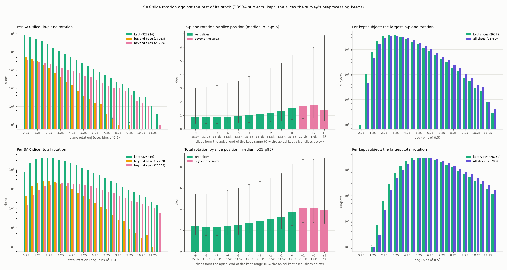

# CMR Motion Correction

Inter-slice motion estimation and correction for cardiac cine MRI: UK Biobank SAX/LAX acquisitions, or any set of
cine slices and stacks as NIfTI or DICOM. A 3D viewer lets you inspect the results.

Every cine acquisition (each short-axis slice, each long-axis view) is taken in its own breath-hold. As a result, the
slices often disagree about where the heart is in scanner space. This slice-alignment pipeline
estimates a rigid pose correction for every SAX slice and long-axis view by optimizing the similarity in image
intensities along the lines where two slices intersect (uses local NCC as a default metric). All slices are penalized
for moving too far from their initial parameters to prevent drift. 
It then writes the corrected images back in the format they were read in.


#### Note: This project was vibe-coded within a couple of days. All praise Claude Code.


---------------------------------------------------------------------------------
---------------------------------------------------------------------------------
## Motion correction pipeline

```
<root>/<subject>/...                      -> your data, one folder per subject (NIfTI or DICOM; layouts below)
            |
            v
moco_nifti.py  /  moco_dicom.py           -> entry points: load a subject, run the motion correction,
            |                                write the corrected images in the same format
            v
motion_gradient.py                        -> the motion correction (library): per-slice rigid poses,
            |                                plus optional metrics and figures (--logging)
            v
slice_viewer_3d.py  /  slice_viewer_dicom.py   -> interactive 3D viewers of the optimization history
```

A first run and a look at its result:

```
python moco_nifti.py --root <ukbb_dir> --out-root <alignment_dir> --run-name my_run
python slice_viewer_3d.py --run-dir <alignment_dir>/my_run
```

## Input data

### UK Biobank NIfTI (`moco_nifti.py`)

Point `--root` at a folder with one subfolder per subject. Inside a subject folder, every folder that holds images is
one **modality** (an acquisition such as cine, T1 or LGE). The UK Biobank download works as is: its `Instance_2/` is
the subject's only modality. Files are classified by name.

```
<root>/
  <subject>/
    Instance_2/                    # a modality folder (any name; a subject may have several)
      SAX.nii.gz                   # SAX stack (X, Y, Z, T), and/or single-slice files SAX_slice<nn>.nii.gz
      LAX_2Ch.nii.gz               # LAX views (X, Y, 1, T); any other NIfTI is an image of its own
      LAX_3Ch.nii.gz
      LAX_4Ch.nii.gz
      ao.nii.gz                    # optional aortic slice
      nnUNet_segs/                 # optional segmentation folder; its name must contain "seg"
        SAX_nnUNetSeg.nii.gz
        LAX_2Ch_nnUNetSeg.nii.gz
        ...
    <another modality>/            # e.g. t1/ with its own SAX stack, views and segmentation folder
```

- **Modalities:** images (2D or 3D, with or without a time axis) and at most one segmentation folder per modality. Any
  other subfolder fails the subject with an error, and the run goes on with the next one. Each modality can have its
  own SAX stack and its own views. Slices of the same modality are compared with `--metric`, slices of different
  modalities with `--cross-mod-metric` (NMI by default, since contrasts differ). With several modalities, the image
  names (in the CSVs) and the output get a `<modality>/` prefix.
- **Segmentations** are the nnU-Net ones of the [Ugurlu et al. pipeline](https://github.com/CEMRG-publications/Ugurlu_2025_PLoS_One) [1].
  They define the heart masks and the Dice / Hausdorff metrics. A segmentation belongs to the image whose file name
  starts its own (e.g. `LAX_2Ch_nnUNetSeg` → `LAX_2Ch`; the longest such name, with a warning if several fit). Files
  that match no image (such as UKBB's `seg_sa.nii.gz`) are ignored, and so are segmentations not stored as integers.
  Missing images or segmentations are allowed.
- **The aortic slice** (`ao.nii.gz`, an axial slice through the ascending aorta) is treated as one more LAX view.
  It has no segmentation, so its lines are masked by the partner image (details below). `--use-ao false` leaves it out.
- **Slice thickness** is not stored in NIfTI headers (only the spacing), so it is set with `--sax-thickness` (8 mm)
  and `--lax-thickness` (6 mm).
- **Output**, per subject: `SAX_slice<nn>.nii.gz`, `LAX_2Ch.nii.gz`, ... with the corrected affines, and the
  segmentations in `nnUNet_segs/` (with several modalities, one such folder per modality). `--image-dtype uint8`
  saves about 30% of the disk space.

### DICOM (`moco_dicom.py`)

For other cine data, e.g. several stacks in different orientations. Every DICOM series below a subject folder is one
image, named after its folder; its slices are the distinct positions and its frames are ordered by `TriggerTime`.

```
<root>/
  <subject>/
    <series_1>/phase_01/*.dcm ... phase_25/*.dcm      # series directly in the subject folder: one modality
    <series_2>/...
    <modality>/<series_3>/...                         # or grouped into modality folders
```

A folder directly in the subject folder is a modality when it holds several series, or a series in a subfolder of its
own. All other series together form one modality.

DICOM data has no segmentations, so the lines are masked by a disc around the centre of each stack instead
(`--center-mask-radius-mm`, 40 mm). The output rewrites every input file at the same relative path, with corrected
`ImagePositionPatient` / `ImageOrientationPatient` and new UIDs. With `--logging`, `metrics/metric_trends.png` shows
whether a run improved, is still improving, or diverged.

```
python moco_dicom.py --root <dicom_dir>                     # output: <dicom_dir>_aligned
python moco_dicom.py --root <dicom_dir> --pair-keep 0.25 --sample-dtype float16   # many slices, small GPU
```

## How the alignment works (`motion_gradient.py`)

`motion_gradient.py` is the motion correction itself; the entry points above call it. In this section we first look at
the idea, then walk through what happens during a run.

### The idea

Every slice gets a **rigid pose**: a 3D translation and a 3D rotation, both starting at zero (the acquired geometry).
To score a set of poses, we pair every two slices whose orientations differ by at least 20°
(`--min-pair-angle-deg`) and sample both images along their **intersection line**. If both slices are in the right
place, the two intensity profiles along that line should look alike. This holds whatever the slices' views or
modalities: every slice is compared with every other one.

Slices closer to parallel than that have no reliable intersection line. They are treated like neighbouring SAX
slices: the slices next to each other in a stack, and the nearest parallel slice of every other image, are recorded as
parallel pairs, and their crossing can be penalized (`--sax-sax-weight`, off by default). Two slices that lie almost in
the same plane, e.g. the same view acquired in two modalities, can also be compared over their whole overlap
(`--coplanar-weight`, off by default).

We measure the agreement with the **local normalized cross-correlation** (`--metric lncc`): the profiles are compared
in 20 mm windows sliding along the line, so every stretch of the line has to match on its own. The score is averaged
over 10 cardiac phases (`--n-frames`) and over all lines. An optimizer (PyTorch, plain SGD) then moves the slices to
maximize it.

How many degrees of freedom a slice gets depends on the images a subject has. With few crossing orientations, a
slice's tilt cannot be determined and is not optimized:

| Available images                                                   | Optimized with `--dof 6`                 |
|--------------------------------------------------------------------|------------------------------------------|
| 3 or more, at least one a stack (SAX + 2 LAX, or 3+ oblique stacks) | full 6-DOF (translation + 3D rotation)   |
| 2, or single-slice LAX views only                                  | translation + in-plane rotation (4-DOF)  |
| fewer than 2                                                       | nothing (images written unaligned)       |

The `pose_model` column of the summary CSV records which model a subject used. Every image is always written to the
output; images that could not be aligned keep their acquired pose.

The method builds on the intersection-line intensity matching of [Stolt-Ansó et al.](https://arxiv.org/pdf/2404.00767) [2].

### How an alignment run proceeds

A run does not optimize the same score from start to finish. Several things change over its 1000 steps (`--steps`):
the learning rate, the heart mask, the image blur and the slice profile. Wide, smooth settings at the start help the
slices find their rough position; tight, sharp settings at the end refine it. All numbers below are the defaults.

#### Learning rate

With plain **SGD** (`--optimizer sgd`), a slice moves by the learning rate times its gradient. There is one learning
rate for translations (`--lr`, 80) and one for rotations (`--rot-lr`, 20).

Both **decay linearly** to 50% of their start value over the run (`--lr-schedule linear`). Why decay at all? At every
step only a random 80% of the lines is used (`--pair-keep`), which makes the gradient noisy. Large early steps move the
slices quickly; smaller late steps let them settle instead of jittering around the optimum.

#### Heart mask and its dilation

The heart moves almost rigidly between breath-holds, but the chest wall and the liver do not. We therefore only use
the part of each line that lies inside a **heart mask**, built from each LAX view's segmentation:

1. **Heart region:** every pixel that a heart label covers in any cardiac frame.
2. **Apex extension:** the region is swept 20 mm toward the apex along the LV long axis (`--apex-extend-mm`). Apical
   segmentations are often incomplete; without this step the apical SAX slices keep few supervised points.
3. **Dilation:** the region is grown by a margin. Only line points inside the grown mask enter the score.

The dilation shrinks from 80 mm to 20 mm over the first 80% of the run (`--mask-dilation-start-mm`,
`--mask-dilation-mm`, `--mask-anneal-frac`). A wide mask gives the optimizer context while the slices are still far
off; the tight mask at the end lets the heart alone decide the final pose.


The dilation changes in 6 stages (`--anneal-stages`), and all intersection lines are rebuilt at each stage:

| Steps    | 0-132 | 133-266 | 267-399 | 400-532 | 533-666 | 667-799 | 800-1000 |
|----------|-------|---------|---------|---------|---------|---------|----------|
| Dilation | 80 mm | 70 mm   | 60 mm   | 50 mm   | 40 mm   | 30 mm   | 20 mm    |

> **Note: lines come and go.** A line only takes part if at least 40 mm of it lie inside both images and the mask
> (`--min-line-mm`). A pair of slices can therefore contribute at a wide dilation and drop out once the mask is tight.
> The 3D viewer marks such pairs as "(not in loss)" at the steps where they do not contribute.

Images without a segmentation have no mask of their own: their lines with a LAX view use that view's mask. The aortic
slice is compared with the SAX slices only within 120 mm of the LV long axis (`--sax-sax-radius-mm`).

#### Annealed blurring

A profile with many small, sharp features gives a score with many small local optima. To avoid getting stuck early,
we work **coarse-to-fine**: all images are blurred in-plane with a Gaussian that narrows over the run.

The blur starts at a sigma of 5 mm (`--blur-sigma`), decreases linearly to 2 mm over the first 80% of the run
(`--blur-sigma-end`, `--blur-frac`), and then stays at 2 mm. The applied sigma moves in steps of 0.2 mm. The blur is
only used inside the optimization; the saved images are never blurred.


At 2 mm the profile keeps its main edges but loses the finest detail, which keeps the score smooth until the end. At
5 mm only the large structures (blood pool, myocardium) remain.

#### Slice profile (PSF)

A slice is not infinitely thin: a SAX slice is 8 mm thick, a LAX view 6 mm. When we sample one image along a line,
we therefore average it across the slab of the other slice, weighted by that slice's profile (the **point-spread
function**, `--psf-model pulse`).

Like the blur, this band starts wider than physical, 3 times the slice profile (`--psf-scale-start`), and narrows to
the physical width over the first 90% of the run (`--psf-anneal-frac`). Unlike the blur, it smooths an image only
across the intersection line, not along it.


#### Late edge term (optional)

Local NCC normalizes every 20 mm window by its own contrast. A window that varies only slightly, e.g. a stretch of
blood pool with some flow artefact or coil shading, therefore pulls about as hard as a window across the myocardial
wall. Only windows that vary by less than `--lncc-min-std` (0.1 of the line's standard deviation) are faded out.

`--edge-weight w` (off by default) blends an edge term into the score of every line toward the end of the run:
(1 - w) x LNCC + w x edge similarity. The weight ramps from 0 to `w` between 80% and 90% of the run
(`--edge-start-frac`, `--edge-ramp-frac`), after the blur and the mask have reached their final values. The edge term
compares the **signed derivatives of both profiles along their shared line**, which is the same 3D directional
derivative in both views. It does not use the in-plane gradient magnitude, which differs between two views even when
they are aligned and cannot tell a rising edge from a falling one (e.g. the endocardial from the epicardial border).
`--edge-metric ncc_grad` (default) correlates the derivatives, so strong edges dominate; `ngf` counts every edge above
`--grad-eps` about equally. An edge metric only finds the optimum once the slices are already close (within about
the blur width), which is why it comes late. Lines between modalities keep `--cross-mod-metric`.

#### Choosing the final pose

The saved pose is not simply the last one. Scores computed with a wide mask or a strong blur cannot be compared with
scores at the end of the run, so the optimizer only starts tracking the **best pose** once every schedule has finished:
from step 900 by default. From there, the full score (all lines) is computed every 10 steps (`--eval-every`) and for
the final pose, and the best of these is saved.

> **Note:** a schedule that lasts the whole run (`--mask-anneal-frac`, `--blur-frac` or `--psf-anneal-frac` set to 1,
> or the edge ramp ending at 1) leaves no tracking window, and the final pose is used.

#### Keeping slices close to their acquired pose:

Across the UK Biobank, 99.9% of the slice corrections are below about 23 mm and 8°. A slice that moves much further has
almost certainly gone wrong, which mostly happens in subjects with few slices. Three mechanisms prevent it, from soft
to hard:

- **Step cap:** at most 2 mm and 1° per optimizer step (`--max-step-mm`, `--max-step-deg`).
- **Dead-zone priors:** free within 20 mm and 10° of the acquired pose; beyond that, a penalty grows with the square of
  the excess (`--shift-prior`, `--shift-free-mm`, `--rot-prior`, `--rot-free-deg`).
- **Hard limits:** never more than 50 mm or 20° (`--max-shift-mm`, `--max-rot-deg`).

A weak **gauge** penalty on the mean pose of all slices (`--gauge`) removes the freedom to move every slice together,
which would not change the score. Setting any of these to 0 switches it off.

#### Example of metrics along optimization:

The figure below shows one subject aligned with the default settings. On the left are the schedules described above;
on the right the metrics of the poses at each step. All metrics are computed with the final 20 mm mask and without
blur, so the steps are comparable.


After a quick jump in the first 20 steps, the metrics keep improving steadily while the mask, blur and slice
profile tighten: Dice levels off around step 600, while NCC keeps rising until the end. For this subject, NCC
rises from 0.72 to 0.86, Dice from 0.61 to 0.77, and the mean Hausdorff distance drops from 30 mm to 18 mm.

#### Recorded metrics (`--logging`)

Every metric is recorded at the acquired pose (`_zero`) and at the saved pose. The values are written per
intersection line (`motion_summary_pairs.csv`), per slice or view (`motion_summary_slices.csv`, the mean over its
lines) and per subject (`motion_summary.csv`).

- **Intensity:** NCC, LNCC (the optimized metric), NMI, and `edge` (the `--edge-metric` similarity, recorded even when
  `--edge-weight` is 0).
- **Segmentation:** Dice and Hausdorff distance of the labels along each line.
- **Long-axis only (`lax_dice`):** the Dice of a view over its LAX-LAX lines only. The long-axis segmentations are
  more reliable than the basal and apical SAX ones, so this is the cleaner signal for whether the views agree.
- **Apex:** on the lines between two of the 2Ch / 3Ch / 4Ch views, which run along the LV long axis, each view's apex
  is the most apical point of the line that its segmentation labels as LV.
  - `apex_mm`: the distance between the two views' epicardial apices (myocardium or blood pool) along the line.
  - `apex_endo_mm`: the same for the endocardial apices (blood pool only); per line only.
  - `apex_dice`: the Dice of the two views' myocardium within 30 mm of the apex.

  The distances have the resolution of the line points (`--line-step-mm`, averaged over the cardiac phases). When only
  one view's line reaches the label, the distance is `--hd-miss-mm`, as for the Hausdorff distance.

The pose history (`history.csv`, `history_summary.csv`) also records `lax_dice` and `apex_mm` at every snapshot. A
view whose long-axis agreement peaks and then falls during the run is being misaligned by the optimizer.


## Running on a SLURM cluster

`submit_alignment.sh` aligns a cohort with `--logging` (metrics and history); `submit_alignment_nolog.sh` writes the
aligned images only. Both resume an interrupted run (`--skip-processed`), and large cohorts can be split into chunks of
subject folders:

```
sbatch submit_alignment.sh --run-name my_run --start-index 0 --end-index 10000
sbatch submit_alignment.sh --run-name my_run --start-index 10000 --end-index 20000
```

## Speed

Three things keep the GPU busy:

- **Batching:** several subjects are aligned in one optimization (`--batch-size`). With the default 0, the first batch
  measures the GPU memory a subject needs, then the batch size doubles for as long as that speeds things up.
- **Worker processes:** loading, preparing the intersection lines and writing the outputs run in parallel processes
  (`--workers`, up to about the number of CPU cores).
- **Coarse early steps:** the first half of the run samples every 4th cine frame and every 2nd line point
  (`--coarse-frac`, `--coarse-frame-stride`, `--coarse-point-stride`).

Seconds per subject with the default settings (1000 steps):

| Machine | Workers | `--logging true` | `--logging false` |
|---|---|---|---|
| RTX 5070 GPU (8 GB), Intel i7-13650HX | 8 | 2.3s | 1.5s |
| NVIDIA A40 (46 GB), AMD EPYC 7662 | 40 | 1.3s | 1.2s |


### Changing the settings

Every option has a general default in `motion_gradient.build_parser`. An entry point repeats the options worth seeing
at a glance with its own defaults, which replace the general ones (e.g. `--sample-dtype` is float32 in
`motion_gradient.py` and float16 in `moco_nifti.py`). `--help` on either entry point lists everything.

To try a variant, align a small batch of subjects into its own run directory and compare:

```
python moco_nifti.py --root <ukbb_dir> --out-root <alignment_dir> --run-name test_blur05 --start-index 0 --end-index 25 --blur-sigma-end 0.5
```

Use a new `--run-name` for every variant. A second run into the same directory overwrites the subjects' images, so
only the newest variant can be opened in the viewer.

The figures in this section are made from one subject by `media/make_readme_figures.py`, using the code itself
(including a fresh alignment for the metrics figure). Regenerate them after changing a default:

```
python media/make_readme_figures.py <ukbb_dir>/<subject>
```
---------------------------------------------------------------------------------
---------------------------------------------------------------------------------
## Visualizing results in the 3D viewer

### `slice_viewer_3d.py`

An interactive PyVista viewer for `moco_nifti.py` runs. Every slice is drawn in scanner space at its pose; a slider
scrubs through the optimization steps. Segmentations, metric-coloured outlines, intersection lines and mask contours
can be toggled. On the right, the intensity profiles along the selected slice's intersection lines are shown as the
loss sees them, with the selected metric per point below (scroll with the mouse wheel).

```
python slice_viewer_3d.py                                    # newest run, its first subject
python slice_viewer_3d.py 1000071 --run <run-name>           # a given subject and run
python slice_viewer_3d.py --remote user@host:/path/to/run --subjects worst_cases/slice_shift_max.txt
```

With `--remote`, subjects are read over ssh from another machine and downloaded once into a local cache. `--subjects`
steps through a list of subjects with `[` / `]`, e.g. one written by `worst_cases.py`. The module docstring lists every
key and mouse action.

### `slice_viewer_dicom.py`

The viewer for `moco_dicom.py` runs, built for subjects with hundreds of slices. Slices are grouped by stack, and only
a subset is drawn at a time: each stack shows its current slice and optionally a few neighbours. A button jumps every
stack to its worst slice by the chosen metric.

```
python slice_viewer_dicom.py vol1302 --run <run-name> --neighbours 3
```

### Finding the worst cases (`worst_cases.py`)

On a large cohort you cannot look at every subject. `worst_cases.py` ranks the subjects of a run by many metrics
(largest single-slice motion, worst slice Dice, NCC lost by the alignment, ...). It writes one list per metric,
worst first, with the slice where each subject is worst.

```
python worst_cases.py --run-dir <alignment_dir>/<run> --top 50
python worst_cases.py --remote user@host:/path/to/run             # runs on the server, only the lists come back
```

`worst_cases_commands.txt` lists ready-made viewer commands for every list.


---------------------------------------------------------------------------------
---------------------------------------------------------------------------------
## Dependencies

- `numpy`, `pandas`, `scipy`
- `nibabel` (NIfTI I/O), `pydicom` (DICOM I/O)
- `torch` (pose optimization)
- `pyvista` (3D viewers)
- `matplotlib` (figures)

```
pip install numpy pandas scipy nibabel pydicom torch pyvista matplotlib
```

---------------------------------------------------------------------------------
---------------------------------------------------------------------------------
## General statistics:
###  UK Biobank

The numbers below are from all 57,724 subjects of the UK Biobank. Segmentations are generated by the trained 
nn-Unet models offered by Ugurlu et al.

What the alignment can do for a subject depends on the images it has:

| Images available | Subjects | Alignment |
|---|---|---|
| SAX stack and at least two long-axis views | 48,047 | full 6-DOF (29,528 of them with an aortic slice) |
| long-axis views, no SAX stack | 4,909 | translation + in-plane rotation |
| no long-axis view | 4,724 | not optimised, written unaligned |
| no readable images | 44 | none |

The SAX statistics in the figures below come from the 48,047 subjects aligned in 6-DOF.

Finding shows that optimizing over intersection intensity similarity (local NCC) leads to improvement in
segmentation similarity along the intersection too: 



**NOTE:** Segmentations are not always accurate. This is especially the case for apical segmentations. Furthermore, 
across different views, basal segmentations disagree, often leading to poor Dice scores despite manual checks 
showing good alignment. 


**Visualized examples:**

Subject with large apical misalignment. Motion corrected parameters result in a large parameter shift beyond the
10 mm threshold, triggering rejection. Similarly, the intersection NCC prior to motion correction triggers the
rejection criteria.


Subject with slightly misaligned LA 4ch view, leading to NCC and DICE of all SA intersection to increase.
However, only 1 mid-ventricular SA slice triggers the rejection criteria.



An example of no motion being present.




**General statistics on computed translations:**



- **Slices beyond the apex move most**: a median in-plane translation of 3.8 mm, against 1.6 mm for the kept slices and
  1.7 mm beyond the base. Their poses rest on short apical profiles with little heart in them, so every judgement uses
  only the kept slices (the coverage test's range).
- **Motion per subject** (top right): the largest in-plane translation of a kept slice. Leaving out the 5 / 10 / 20 %
  of the kept subjects that moved most means a limit of 12.6 / 10.1 / 7.6 mm.

**General statistics on computed rotations:**



- **Rotation**: medians of 1.1° in-plane and 2.7° in total for the kept slices (1.8° and 4.2° beyond the apex);
  reported, not judged (the tilt rests on three crossing lines only).


  

---------------------------------------------------------------------------------
---------------------------------------------------------------------------------
## References

[1] Ugurlu, D., Qian, S., Fairweather, E., Mauger, C., Ruijsink, B., Dal Toso, L., Deng, Y.,
Strocchi, M., Razavi, R., Young, A., et al. (2025). Cardiac digital twins at scale from MRI: open
tools and representative models from ~55000 UK Biobank participants. *PLOS ONE*, 20(7), e0327158.
Code: https://github.com/CEMRG-publications/Ugurlu_2025_PLoS_One

```bibtex
@article{ugurlu2025cardiac,
  title={Cardiac digital twins at Scale from MRI: open tools and representative models from~55000 UK Biobank participants},
  author={Ugurlu, Devran and Qian, Shuang and Fairweather, Elliot and Mauger, Charlene and Ruijsink, Bram and Toso, Laura Dal and Deng, Yu and Strocchi, Marina and Razavi, Reza and Young, Alistair and others},
  journal={Plos one},
  volume={20},
  number={7},
  pages={e0327158},
  year={2025},
  publisher={Public Library of Science, San Francisco, CA USA}
}
```

[2] Stolt-Ansó, N., Sideri-Lampretsa, V., Dannecker, M., & Rueckert, D. (2024). Intensity-based 3D
motion correction for cardiac MR images. In *2024 IEEE International Symposium on Biomedical
Imaging (ISBI)* (pp. 1-4). IEEE.

```bibtex
@inproceedings{stolt2024intensity,
  title={Intensity-based 3D motion correction for cardiac MR images},
  author={Stolt-Ans{\'o}, Nil and Sideri-Lampretsa, Vasiliki and Dannecker, Maik and Rueckert, Daniel},
  booktitle={2024 IEEE International Symposium on Biomedical Imaging (ISBI)},
  pages={1--4},
  year={2024},
  organization={IEEE}
}
```
