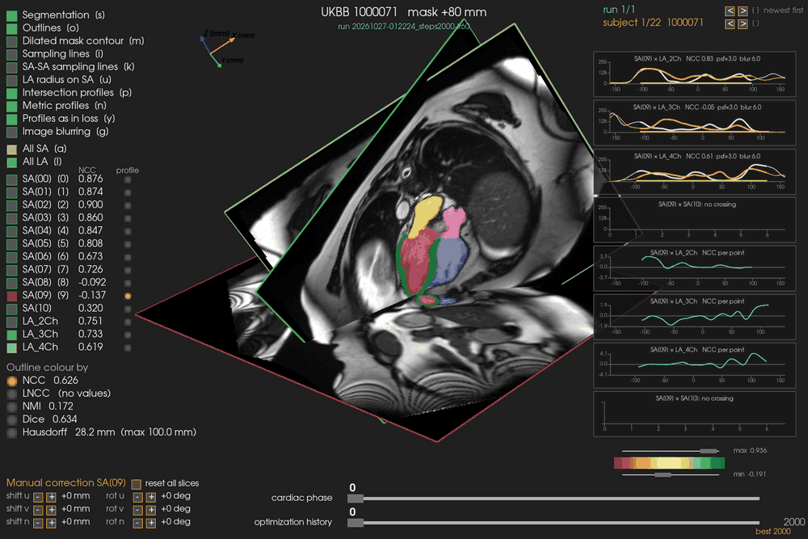

# CMR Motion Correction

Inter-slice motion estimation and correction for cardiac MRI (UK Biobank cine SAX/LAX
acquisitions), plus a 3D viewer for inspecting alignment results.

Different cine acquisitions (each short-axis slice, each long-axis view) are breath-held
independently, so they commonly disagree about where the heart actually is in scanner space.
This pipeline estimates a rigid pose correction per slice/view by comparing image intensities
along the 3D lines where pairs of planes intersect, then writes out motion-corrected NIfTIs.

## Pipeline

```
download_ukbb.py                          -> raw per-subject NIfTIs (SSH from a remote data store)
            |
            v
prepare_ukbb_slices.py                    -> single-slice layout expected by motion_gradient.py
            |
            v
motion_gradient.py                        -> estimates per-plane rigid poses, writes corrected NIfTIs (+ optional metrics/figures)
            |
            v
slice_viewer_3d.py                        -> interactive 3D viewer over the optimization history
```

### `download_ukbb.py`

Downloads subjects from a remote dataset over a single SSH connection (tar-streamed, so you're
only prompted for a password/key once), in sorted batches, tracking already-downloaded subjects
(`.downloaded_subjects.txt`) so reruns only fetch new ones.

The dataset is expected to hold UK Biobank cine SAX/LAX acquisitions together with nnU-Net
segmentations in the style of Ugurlu et al. [1].

```
python download_ukbb.py --host user@server --n-subjects 50
```

Run with `--help` for all options (remote/local directories, batch size, `--refresh-list`,
`--flatten`, ...).

### `prepare_ukbb_slices.py`

Converts the downloaded per-subject layout (SAX stack, LAX_2Ch/3Ch/4Ch, nnU-Net segmentations)
into the single-slice-per-file layout `motion_gradient.py` expects: every SAX slice becomes its
own NIfTI with its own affine (origin shifted along the stack normal), LAX views are copied
unchanged, and segmentation labels are rounded to clean integers. Wrapper folders (e.g.
`Instance_2`) are detected and flattened automatically. The nnU-Net segmentations are expected
to be the ones produced by the [Ugurlu et al. pipeline](https://github.com/CEMRG-publications/Ugurlu_2025_PLoS_One) [1].

```
python prepare_ukbb_slices.py --src <downloaded_dir> --dst <slices_dir> --workers 8
```

`motion_gradient.py` expects the destination (`--dst`) to hold one folder per subject, laid out
like this:

```
<dst>/
  <subject>/
    SAX_slice00.nii.gz            # one file per SAX slice, (X, Y, 1, T), own affine
    SAX_slice01.nii.gz
    ...
    LAX_2Ch.nii.gz                 # (X, Y, 1, T)
    LAX_3Ch.nii.gz
    LAX_4Ch.nii.gz
    nnUNet_segs/
      SAX_slice00_nnUNetSeg.nii.gz
      SAX_slice01_nnUNetSeg.nii.gz
      ...
      LAX_2Ch_nnUNetSeg.nii.gz
      LAX_3Ch_nnUNetSeg.nii.gz
      LAX_4Ch_nnUNetSeg.nii.gz
  <subject>/
    ...
  prepare_log.csv                  # one row per subject (what was written)
```

See the module docstring for the exact source layout and `--help` for all options
(`--max-subjects`, `--overwrite`, ...).

### `motion_gradient.py`

For every pair of non-parallel planes (SAX-LAX and LAX-LAX), samples intensity profiles along
their 3D intersection line (restricted to a dilated heart mask from the LAX segmentations) and
optimizes a 6-DOF rigid pose per plane (PyTorch, Adam/SGD) to maximize agreement across cardiac
phases. Optional SAX-stack regularizers keep neighbouring slices from tilting, drifting apart, or
crossing. Always writes motion-corrected NIfTIs in the input layout; with `--logging`, also writes
per-subject and dataset-level metrics (CSV) and figures (PNG) under the run directory. The method
builds on the intersection-line intensity-matching approach of
[Stolt-Ansó et al.](https://arxiv.org/pdf/2404.00767) [2].

We found best results with plain SGD (`--optimizer sgd`, no momentum) rather than Adam. There is
also a substantial amount of non-rigid deformation in the torso between acquisitions (the heart
itself moves close to rigidly, but the surrounding anatomy does not), so the intersection-line
optimization is restricted to a dilated foreground (heart) mask derived from the LAX
segmentations, rather than the full extent of each line, to keep it from being pulled off by
non-rigid motion further out.

```
python motion_gradient.py --root <slices_dir> --out-root <alignment_dir> --max-subjects -1 --logging true --optimizer sgd --momentum 0
```

This script has a large number of tuning options (optimizer/schedule, blur coarse-to-fine,
stack regularizers, similarity metric, point-spread-function model, mask annealing, ...) — see
the module docstring for the full method description and `--help` for every flag.

### `slice_viewer_3d.py`

Interactive PyVista viewer that renders every SAX slice and LAX view as a textured quad in
scanner/world space, using the poses from a `motion_gradient.py` run's optimization history
(`metrics/history.csv`). A slider scrubs through optimization steps; segmentation overlays,
per-plane similarity-metric coloring, intersection lines and mask contours can be toggled.

```
python slice_viewer_3d.py                      # most recently created run, its first subject
python slice_viewer_3d.py 1000071               # a specific subject
python slice_viewer_3d.py 1000071 --run <run-name>
```



See the module docstring for the full keyboard/mouse interaction reference.

## Dependencies

- `numpy`, `pandas`, `scipy`
- `nibabel` (NIfTI I/O)
- `torch` (pose optimization)
- `pyvista` (3D viewer)
- `matplotlib` (figures, `motion_gradient.py --logging`)
- `paramiko` (`download_ukbb.py`)

```
pip install numpy pandas scipy nibabel torch pyvista matplotlib paramiko
```

## References

[1] Ugurlu, D., Qian, S., Fairweather, E., Mauger, C., Ruijsink, B., Dal Toso, L., Deng, Y.,
Strocchi, M., Razavi, R., Young, A., et al. (2025). Cardiac digital twins at scale from MRI: open
tools and representative models from ~55000 UK Biobank participants. *PLOS ONE*, 20(7), e0327158.
Code: https://github.com/CEMRG-publications/Ugurlu_2025_PLoS_One

```bibtex
@article{ugurlu2025cardiac,
  title={Cardiac digital twins at Scale from MRI: open tools and representative models from~55000 UK Biobank participants},
  author={Ugurlu, Devran and Qian, Shuang and Fairweather, Elliot and Mauger, Charlene and Ruijsink, Bram and Toso, Laura Dal and Deng, Yu and Strocchi, Marina and Razavi, Reza and Young, Alistair and others},
  journal={Plos one},
  volume={20},
  number={7},
  pages={e0327158},
  year={2025},
  publisher={Public Library of Science, San Francisco, CA USA}
}
```

[2] Stolt-Ansó, N., Sideri-Lampretsa, V., Dannecker, M., & Rueckert, D. (2024). Intensity-based 3D
motion correction for cardiac MR images. In *2024 IEEE International Symposium on Biomedical
Imaging (ISBI)* (pp. 1-4). IEEE.

```bibtex
@inproceedings{stolt2024intensity,
  title={Intensity-based 3D motion correction for cardiac MR images},
  author={Stolt-Ans{\'o}, Nil and Sideri-Lampretsa, Vasiliki and Dannecker, Maik and Rueckert, Daniel},
  booktitle={2024 IEEE International Symposium on Biomedical Imaging (ISBI)},
  pages={1--4},
  year={2024},
  organization={IEEE}
}
```
